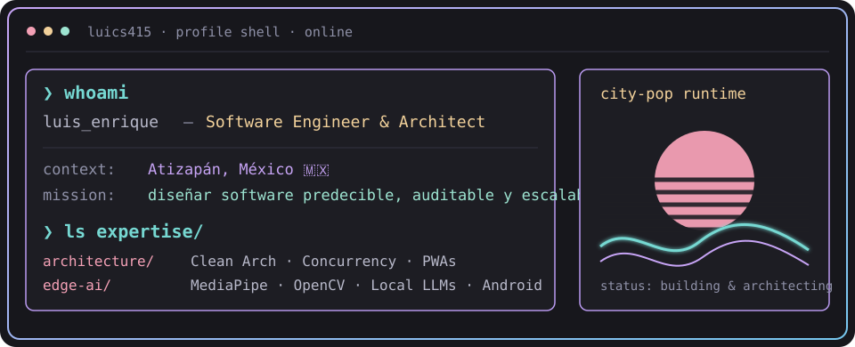

  

<!-- HERO TYPING ANIMATION -->

 

  <b>Construyendo arquitecturas limpias, interfaces cinematográficas e inteligencia artificial en el borde.</b>

<!-- STATUS PILLS / BADGES DINÁMICOS -->

  
  
  

 

---

<!-- LOCAL RETRO CITY-POP TERMINAL BANNER -->
<a href="https://github.com/Luics415">
  <picture>
    <source media="(prefers-color-scheme: dark)" srcset="assets/banner-dark.v9.svg">
    <source media="(prefers-color-scheme: light)" srcset="assets/banner-light.v9.svg">
    
  </picture>
</a>

 

 

---

## `$ whoami`

  

 

<!-- PACMAN CONTRIBUTION GRAPH MOVED BETWEEN WHOAMI AND TECH-STACK -->

<picture data-importer="pacman">
  <source media="(prefers-color-scheme: dark)" srcset="https://raw.githubusercontent.com/Luics415/Luics415/pacman-output/pacman-contribution-graph-dark.svg?game=pacman">
  <source media="(prefers-color-scheme: light)" srcset="https://raw.githubusercontent.com/Luics415/Luics415/pacman-output/pacman-contribution-graph.svg?game=pacman">
  
</picture>

 

---

## `$ cat tech-stack.yaml`

<table border="1" cellpadding="14" bgcolor="#17171c">
  <thead>
    <tr>
      <th colspan="2" align="left"><code>luics415:~$ cat tech-stack.yaml</code></th>
    </tr>
  </thead>
  <tbody>
    <tr>
      <td width="50%" valign="top"><code>├─ ⚙ backend_systems:</code>  
         
        <code>Kotlin · Python · C++ · C# · Node.js · Java</code>
      </td>
      <td width="50%" valign="top"><code>├─ 🌐 frontend_pwa:</code>  
         
        <code>TypeScript · JavaScript · React · Next.js · TailwindCSS</code>
      </td>
    </tr>
    <tr>
      <td valign="top"><code>├─ 🤖 edge_ai_vision:</code>  
        
        
         
        <code>Local LLMs · GGUF · MediaPipe · OpenCV · WebGL · Three.js</code>
      </td>
      <td valign="top"><code>├─ 📱 mobile_architecture:</code>  
         
        <code>Android Native · Jetpack Compose · Offline-First · Coroutines</code>
      </td>
    </tr>
    <tr>
      <td valign="top"><code>├─ 💾 databases_storage:</code>  
         
        <code>PostgreSQL · MongoDB · SQLite · Redis</code>
      </td>
      <td valign="top"><code>╰─ 🛠️ devops_toolchain:</code>  
         
        <code>Git · GitHub Actions · CI/CD · Linux CLI · Shell Scripting</code>
      </td>
    </tr>
  </tbody>
  <tfoot>
    <tr>
      <td colspan="2"><code>status: ready&nbsp;&nbsp;·&nbsp;&nbsp;environment: production</code></td>
    </tr>
  </tfoot>
</table>

 

  
  
  
  
  
  
  
  
  

---

## `$ git log --signals --all-branches`

  <picture>
    <source media="(prefers-color-scheme: dark)" srcset="assets/radar-dark.svg">
    <source media="(prefers-color-scheme: light)" srcset="assets/radar-light.svg">
    
  </picture>&nbsp;&nbsp;
  <picture>
    <source media="(prefers-color-scheme: dark)" srcset="assets/radar-langs-dark.svg">
    <source media="(prefers-color-scheme: light)" srcset="assets/radar-langs-light.svg">
    
  </picture>

<code>signals: software_engineering_skill_radar · language_stack_radar · status: healthy</code>

---

## `$ ls -la featured-projects/`

<table>
  <tr>
    <td width="50%" valign="top">
      <h3>🤖 <a href="https://github.com/Luics415/Ancla">Ancla — Local AI Assistant</a></h3>
      
Asistente de inteligencia artificial local para Android desarrollado en <b>Kotlin</b>. Inferencia privada on-device sin dependencia de nubes externas ni fugas de privacidad.

      

        
        
        
      

    </td>
    <td width="50%" valign="top">
      <h3>📊 <a href="https://github.com/Luics415/Dev-Visualizer">Dev-Visualizer — Visual Atlas</a></h3>
      
Biblioteca interactiva en <b>TypeScript</b> que transforma conceptos de ingeniería complejos en representaciones visuales autónomas y didácticas.

      

        
        
        
      

    </td>
  </tr>
  <tr>
    <td width="50%" valign="top">
      <h3>🧊 <a href="https://github.com/Luics415/QRVoxelStudio">QRVoxelStudio — 3D QR Engine</a></h3>
      
Plataforma para dar ambientación visual y dimensión 3D basada en vóxeles a códigos QR estándar, renderizada con WebGL en tiempo real.

      

        
        
      

    </td>
    <td width="50%" valign="top">
      <h3>🦜 <a href="https://github.com/Luics415/AussieCare">AussieCare — PWA Cinematográfica</a></h3>
      
PWA offline-first, mobile-first con UI cinematográfica para guiar el cuidado responsable de periquitos australianos con accesibilidad rigurosa.

      

        
        
        
      

    </td>
  </tr>
  <tr>
    <td width="50%" valign="top">
      <h3>🖐️ <a href="https://github.com/Luics415/Bio-Gesture-Control-Pro">Bio-Gesture Control Pro</a></h3>
      
Control del sistema operativo Windows mediante reconocimiento de gestos manuales con <b>MediaPipe</b> y <b>Python</b>, procesado localmente en tiempo real.

      

        
        
        
      

    </td>
    <td width="50%" valign="top">
      <h3>⚔️ <a href="https://github.com/Luics415/AnchorGrid">AnchorGrid — Tactical Turn Game</a></h3>
      
Juego de estrategia por turnos, multiplataforma y mobile-first con soporte para partidas multijugador online, local y motor de IA contrincante.

      

        
        
      

    </td>
  </tr>
</table>

---

## `$ play snake-animation`

  

---

## `$ cat system-stats.log`

  
  

 

  

---

## `$ connect --socials`

  
  &nbsp;
  
  &nbsp;
  
    
  
  &nbsp;
  
  &nbsp;
  

  

⚡ Hecho con precisión técnica y arquitectura limpia desde Atizapán, México · @Luics415

